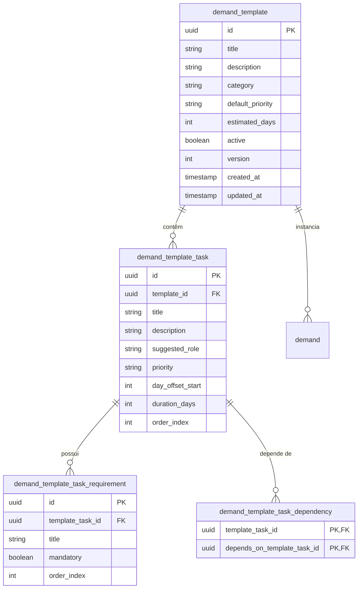

# Mapeamento Técnico de Backend e Performance — Fase 11 (Refinamento)

**Data:** 14/10/2026  
**Status:** Mapeamento Técnico Somente-Leitura (Planejamento e Arquitetura)  
**Referência:** `ROADMAP.md` (Fase 11 — Refinamento: gargalos, UX, templates, relatórios e performance)  
**Ambiente de Produção Vigente:** VPS Host (`app.oriumdigital.tech`), Docker Compose `orium-production`, PostgreSQL 17.11 (`orium_prod`), Backup com Systemd Timer Diário (`03:00 America/Cuiaba`).

---

## 1. Diagnóstico Técnico de Gargalos e Performance

Uma auditoria minuciosa nas rotas e consultas das Fases 1 a 10 revelou oportunidades críticas de otimização no backend à medida que o volume de clientes, demandas, tarefas e notificações crescer.

### 1.1. Análise por Módulo

#### A. Clientes (`apps/api/src/clients.ts`)
1. **Busca Textual com `ILIKE`:**
   - Na rota `listClients`, o filtro de busca textual executa:
     ```sql
     (name ILIKE $1 ESCAPE '\' OR contact_name ILIKE $1 ESCAPE '\' OR email ILIKE $1 ESCAPE '\')
     ```
   - O índice existente na tabela `client` é B-Tree em `name`. O operador `ILIKE '%...%'` com wildcard à esquerda invalida o uso do índice B-Tree, forçando **Seq Scan** integral na tabela.
2. **Dupla Consulta para Paginação:**
   - Executa `SELECT count(*)::int AS total` e logo após o `SELECT ... LIMIT ... OFFSET`. Em bancos com dezenas de milhares de registros, um `count(*)` com múltiplos filtros de texto sem índice trigram consome tempo desnecessário de CPU.

#### B. Demandas e Tarefas (`apps/api/src/demands.ts`)
1. **Verificação de Acesso do Colaborador (Anti-IDOR):**
   - Na rota `listDemands`, para usuários não-administradores, o filtro aplica:
     ```sql
     EXISTS (SELECT 1 FROM task t WHERE t.demand_id = d.id AND t.assigned_to_user_id = $userId)
     ```
   - A tabela `task` possui índices separados: `task_demand_id_idx` em `(demand_id)` e `task_assigned_to_user_id_idx` em `(assigned_to_user_id)`.
   - **Gargalo:** Não existe índice composto `(assigned_to_user_id, demand_id)`. Para cada demanda filtrada, o planejador do PostgreSQL precisa fazer Bitmap Index Scan ou Nested Loop para correlacionar os dois índices separados.
2. **Busca Textual em Demandas:**
   - O campo `description` possui até 5.000 caracteres. A cláusula `(d.title ILIKE $1 OR d.description ILIKE $1)` força leitura de páginas TOAST no disco caso a descrição seja longa, sem qualquer suporte a índice.
3. **Ordenação Padrão:**
   - `ORDER BY d.created_at DESC, d.id DESC`. Quando combinado com filtros frequentes (`status = 'open'` e `client_id = ...`), a falta de índice composto obriga o PostgreSQL a ordenar em memória via `Sort / Top-N heapsort`.

#### C. Dashboard Operacional (`apps/api/src/dashboard.ts`)
1. **Processamento em Memória no Node.js:**
   - O endpoint `getDashboard` atualmente faz uma busca ampla de **todas as tarefas não-concluídas** de chamados abertos:
     ```sql
     SELECT ... FROM task t JOIN demand d ... WHERE t.status != 'completed' AND d.status != 'completed'
     ```
   - Em seguida, itera em memória sobre todo o conjunto de tarefas em um laço JavaScript (`for (const t of tasks)`), classificando cada tarefa em 6 categorias distintas:
     - `productionItems`
     - `awaitingActionItems`
     - `overdueTaskItems`
     - `dueTodayItems`
     - `upcomingItems`
     - `urgentItems`
   - **Gargalo:** Para 100 tarefas ativas isso é instantâneo (< 5ms). Quando a agência tiver 5.000 tarefas ativas ou pausadas em andamento, o payload transferido do PostgreSQL para o Node.js e o loop síncrono no Event Loop degradarão o tempo de resposta e aumentarão a pegada de RAM do container da API.
2. **Subconsulta Correlacionada em Carga de Equipe (`workload`):**
   - A agregação de carga da equipe executa:
     ```sql
     LEFT JOIN task t ON t.assigned_to_user_id = u.id AND t.status != 'completed'
       AND EXISTS (SELECT 1 FROM demand d WHERE d.id = t.demand_id AND d.status != 'completed')
     ```
   - O predicado `EXISTS` correlacionado é avaliado para cada linha de tarefa associada ao usuário.

#### D. Materiais e Linha do Tempo (`apps/api/src/materials.ts`)
1. **CTE Unificada com 3 `UNION ALL`:**
   - Em `getClientTimeline`, a consulta monta uma CTE unindo `demand_event`, `task` via `demand_event`, e `material_event`.
   - A query executa a CTE inteira duas vezes: uma vez para calcular o `SELECT count(*)::int AS total` e outra vez para o `SELECT ... LIMIT ... OFFSET`.
   - Na ausência de índices nos pares `(demand_id, created_at)` e `(material_id, created_at)`, os sorts e joins da timeline consomem buffers de trabalho consideráveis (`work_mem`).

#### E. Notificações (`apps/api/src/notifications.ts` e `notifications-calendar.ts`)
1. **Materialização Sincronizada no Endpoint de Leitura:**
   - Cada chamada `GET /api/v1/notifications` executa `materializeCalendarNotifications`, que busca demandas e tarefas com entrega vencendo hoje ou amanhã e faz inserções com `ON CONFLICT DO NOTHING`.
   - Embora o lock `FOR SHARE` em `auth_session` serialize a segurança de expiração e tokens, a materialização durante a leitura impõe escrita concorrente em requisições de consulta frequentes de polling do frontend.

---

### 1.2. Mapeamento de Índices: Existentes vs. Recomendados

Abaixo está o inventário comparativo e o plano cirúrgico de índices recomendados para a migração da Fase 11 (`0006_performance_and_templates.sql`):

| Tabela | Índices Existentes | Índices Recomendados para Fase 11 | Benefício de Performance |
| :--- | :--- | :--- | :--- |
| **`demand`** | `client_id`<br>`created_by_user_id`<br>`status`<br>`delivery_date`<br>`created_at` | **`idx_demand_status_created_at`**<br>`(status, created_at DESC)` | Acelera `listDemands` padrão (chamados abertos ordenados por mais recentes), eliminando sort em memória. |
| **`demand`** | (nenhum composto) | **`idx_demand_client_status_delivery`**<br>`(client_id, status, delivery_date)` | Otimiza filtros de cliente no Dashboard, Timeline e listagens agrupadas. |
| **`demand`** | (nenhum índice textual) | **`idx_demand_search_trgm`** (GIN)<br>`USING gin (title gin_trgm_ops)` | Transforma `title ILIKE '%busca%'` de Seq Scan em Index Scan veloz (requer extensão `pg_trgm`). |
| **`task`** | `demand_id`<br>`assigned_to_user_id`<br>`status`<br>`delivery_date` | **`idx_task_assigned_status_delivery`**<br>`(assigned_to_user_id, status, delivery_date)` | Acelera drasticamente a query do Dashboard pessoal do colaborador (visão `scope = 'assigned'`). |
| **`task`** | `demand_id`<br>`assigned_to_user_id` (separados) | **`idx_task_assigned_demand`**<br>`(assigned_to_user_id, demand_id)` | Otimiza `EXISTS (SELECT 1 FROM task WHERE demand_id = d.id AND assigned_to_user_id = $1)` em `listDemands` e IDOR checks. |
| **`task`** | (nenhum parcial) | **`idx_task_active_status`** (Parcial)<br>`(demand_id, status)`<br>`WHERE status != 'completed'` | Reduz em até 80% o tamanho do índice, cobrindo exclusivamente as tarefas operacionais ativas. |
| **`demand_event`**| `demand_id`<br>`task_id`<br>`actor_id`<br>`created_at` | **`idx_demand_event_demand_created`**<br>`(demand_id, created_at DESC)` | Acelera o histórico de demandas (`getDemandHistory`) e o join da Timeline do Cliente. |
| **`client`** | `name`<br>`archived_at`<br>`created_at` | **`idx_client_search_trgm`** (GIN)<br>`USING gin (name gin_trgm_ops)` | Acelera autocomplete e busca instantânea de clientes na UI. |

---

## 2. Arquitetura Proposta: Templates de Demandas e Tarefas

### 2.1. Motivação e Regra de Negócio
No dia a dia da Orium, muitos projetos seguem processos operacionais padronizados. Criar manualmente um chamado de "Identidade Visual" ou "Landing Page" e em seguida cadastrar 6 a 10 tarefas com suas respectivas dependências e checklists é repetitivo e suscetível a erros humanos.

Os **Templates de Demandas** permitirão ao gestor selecionar um modelo predefinido ao abrir um chamado, gerando a estrutura completa de tarefas, prazos calculados e critérios de aceitação automaticamente.

### 2.2. Modelo de Dados Proposto (Drizzle / PostgreSQL)



### 2.3. Especificação das Tabelas

1. **`demand_template`**:
   - `id`: `uuid` chave primária.
   - `title`: `text` (ex.: "Criação de Landing Page de Alta Conversão", "Branding & Identidade Visual").
   - `description`: `text` detalhando o escopo do serviço.
   - `category`: `text` (`web`, `design`, `video`, `marketing`, `social_media`).
   - `default_priority`: `text` enum (`low`, `normal`, `high`, `urgent`), padrão `normal`.
   - `estimated_days`: `integer` não-nulo (prazo total sugerido da demanda em dias corridos ou úteis).
   - `active`: `boolean` padrão `true` (permite desativar sem quebrar histórico).
   - `version`: `integer` para concorrência otimista.

2. **`demand_template_task`**:
   - `id`: `uuid` chave primária.
   - `template_id`: `uuid` FK para `demand_template` (`ON DELETE CASCADE`).
   - `title`: `text` (ex.: "1. Wireframe e Estrutura de Copy", "2. Design UI no Figma", "3. Desenvolvimento Webflow/Tailwind").
   - `description`: `text` com instruções do padrão de qualidade.
   - `suggested_role`: `text` enum (`designer`, `copywriter`, `developer`, `reviewer`).
   - `priority`: `text` enum (`normal`, `high`, etc.).
   - `day_offset_start`: `integer` (dias a partir da data de início da demanda em que esta tarefa deve começar).
   - `duration_days`: `integer` (duração em dias para conclusão desta tarefa).
   - `order_index`: `integer` para ordenação visual na interface.

3. **`demand_template_task_requirement`**:
   - `id`: `uuid` chave primária.
   - `template_task_id`: `uuid` FK para `demand_template_task` (`ON DELETE CASCADE`).
   - `title`: `text` (ex.: "Link do briefing no Drive anexado", "Revisão ortográfica concluída").
   - `mandatory`: `boolean` padrão `true`.
   - `order_index`: `integer`.

4. **`demand_template_task_dependency`**:
   - `template_task_id`: `uuid` FK para `demand_template_task` (`ON DELETE CASCADE`).
   - `depends_on_template_task_id`: `uuid` FK para `demand_template_task` (`ON DELETE CASCADE`).
   - Chave primária composta `(template_task_id, depends_on_template_task_id)`.

### 2.4. Fluxo Transacional de Instanciação (`createDemandFromTemplate`)

Ao invocar o endpoint de criação a partir de template:
1. **Validação de Entrada:**
   - `clientId`: UUID do cliente ativo.
   - `templateId`: UUID do template ativo.
   - `title`: Título customizado (padrão herdado do template se não informado).
   - `startDate`: Data de início (`YYYY-MM-DD`). Se omitida, adota `today` (`America/Cuiaba`).
   - `assignments`: Dicionário opcional mapeando `orderIndex` ou `templateTaskId` para `userId` de colaboradores reais.
2. **Execução em Bloco Atômico (Lock Transacional):**
   - Abre transação com `pg_advisory_xact_lock(IDENTITY_LOCK)`.
   - Revalida permissão `demands.write` do usuário autenticado.
   - Calcula a data de entrega final da demanda (`startDate + estimated_days`).
   - Cria o registro em `demand`.
   - Gera um mapa em memória `Map<templateTaskId, realTaskId>` com novos UUIDs.
   - Calcula as datas de entrega de cada tarefa (`startDate + day_offset_start + duration_days`).
   - Insere todas as tarefas via batch insert. Tarefas sem dependências já iniciam com status `ready`; tarefas com dependências iniciam com status `blocked`.
   - Converte as referências de `demand_template_task_dependency` para os novos `realTaskId` e insere em `task_dependency`.
   - Insere todos os requisitos pré-definidos em `task_requirement`.
   - Registra evento único de auditoria `demand_created_from_template` e dispara as notificações iniciais.
   - Efetua `COMMIT`.

---

## 3. Arquitetura Proposta: Relatórios Operacionais

### 3.1. Necessidade de Inteligência Operacional
O OriumSystem possui uma riqueza de dados de histórico (`demand_event`, timestamps em `task` como `accepted_at`, `ready_at`, `started_at`, `completed_at`, `paused_at`, `pause_requested_at`), mas que atualmente só são visualizados isoladamente por tarefa.

A arquitetura de relatórios consolidará esses dados em indicadores-chave de desempenho (KPIs) para a gestão da agência.

### 3.2. Indicadores e Métricas Chave (KPIs)

1. **Eficiência de Fluxo e Ciclo de Vida (Cycle Time & Lead Time):**
   - **Lead Time da Demanda:** Tempo total decorrido entre a criação do chamado e a entrega final (`completed`).
   - **Cycle Time da Tarefa:** Tempo decorrido entre o início real da produção (`started_at`) e a conclusão aprovada (`completed_at`).
   - **Tempo de Fila / Bloqueio:** Tempo médio em que uma tarefa permanece em `blocked` ou `ready` aguardando ação.
   - **Tempo de Pausa:** Quantidade total de horas em que tarefas ficaram em `paused` e principais motivos registrados (`pause_reason`).
   - **Taxa de Retrabalho (Review Friction):** Média de solicitações de alteração (`changes_requested`) antes da aprovação final.

2. **Produtividade e Throughput:**
   - **Taxa de Conclusão (Throughput):** Volume de demandas e tarefas concluídas por semana / mês.
   - **Taxa de Cumprimento de Prazo (On-Time Delivery Rate - OTD):**
     $$\text{OTD} = \frac{\text{Demandas concluídas na data limite ou antes}}{\text{Total de demandas concluídas}} \times 100$$
   - **Distribuição de Carga:** Volume de horas ativas e volume de entregas por colaborador.

3. **Visão por Cliente (Client Health & Output):**
   - Demandas entregues vs. canceladas vs. em andamento.
   - Volume de materiais produzidos e links publicados (`materials`).
   - Tempo médio de resposta do cliente para fornecimento de requisitos ou validação de prévias.

### 3.3. Endpoints e Contratos de API Propostos

Todos os endpoints de relatório devem residir sob o namespace protegido `/api/v1/reports/` e exigir a permissão `demands.read` (e dados de usuários limitados para não-administradores):

```typescript
// Exemplo de contratos de entrada e saída
export const reportDateRangeQuerySchema = z.object({
  startDate: calendarDateSchema,
  endDate: calendarDateSchema,
  clientId: z.string().uuid().optional(),
  userId: z.string().optional(),
  groupBy: z.enum(['day', 'week', 'month']).default('week'),
});

export const productivityReportResponseSchema = z.object({
  period: z.object({ startDate: z.string(), endDate: z.string() }),
  summary: z.object({
    demandsCreated: z.number().int(),
    demandsCompleted: z.number().int(),
    tasksCompleted: z.number().int(),
    onTimeDeliveryRate: z.number().min(0).max(100),
    averageLeadTimeHours: z.number(),
    averageCycleTimeHours: z.number(),
  }),
  series: z.array(z.object({
    date: z.string(),
    created: z.number().int(),
    completed: z.number().int(),
  })),
  byAssignee: z.array(z.object({
    userId: z.string(),
    userName: z.string(),
    tasksCompleted: z.number().int(),
    averageCycleTimeHours: z.number(),
    onTimeRate: z.number().min(0).max(100),
  })),
});
```

1. **`GET /api/v1/reports/productivity`**:
   - Métricas globais de entrega, throughput e cumprimento de prazos.
2. **`GET /api/v1/reports/cycle-time`**:
   - Análise detalhada dos estágios do pipeline (tempo em `blocked`, `ready`, `in_production`, `in_review`, `paused`).
3. **`GET /api/v1/reports/client-overview`**:
   - Painel analítico filtrado por cliente (histórico de entregas, materiais e prazos médios).

### 3.4. Otimização de Consultas Analíticas

Para assegurar que relatórios não onerem as transações de escrita do banco de produção:
1. **Transações Isoladas Read-Only:**
   - Todas as queries de relatório devem rodar sob `BEGIN TRANSACTION ISOLATION LEVEL READ COMMITTED READ ONLY`.
2. **Uso de Agregações Nativas em SQL:**
   - Cálculo de médias, medianas (`PERCENTILE_CONT(0.5) WITHIN GROUP (ORDER BY ...)`), e janelas de data (`date_trunc`) diretamente no motor do PostgreSQL, evitando tráfego de dados brutos para a aplicação.
3. **Estratégia de Cache e Materialização Futura:**
   - Dados de períodos já encerrados (ex.: meses anteriores) são imutáveis. O backend pode utilizar uma tabela de consolidação diária (`daily_metrics_rollup`) preenchida por rotina noturna (após o backup das 03:00) para respostas sub-milissegundo.

---

## 4. Próximos Passos Recomendados

1. **Apresentação à Coordenação (`Antigravity #2` / Codex):**
   - Submissão deste mapeamento técnico para validação das entidades de templates e escopo de relatórios.
2. **Definição de Contratos em `@orium/contracts`:**
   - Criação dos schemas Zod e tipos TypeScript para templates de demandas e endpoints de relatórios.
3. **Elaboração da Migração `0006_performance_and_templates.sql`:**
   - Criação cirúrgica dos índices recomendados (Seção 1.2) e das tabelas de templates (Seção 2.2).
4. **Implementação de Rota e Componentes UI:**
   - Implementação modular com testes de integração e componentes no `@orium/web`.
