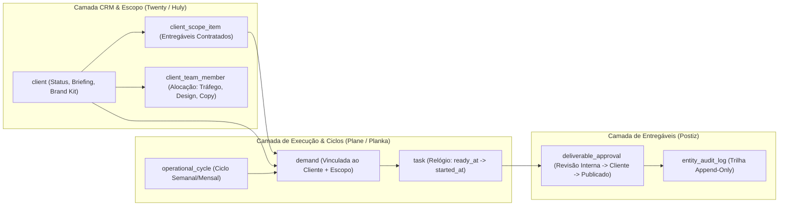

# OriumSystem — Benchmark Arquitetural e Plano de Evolução (Agency OS & Controle de Equipe)

**Data de Elaboração**: 2026-10-14  
**Escopo**: Auditoria da Fundação (Fase 1 e módulos base), Benchmark Técnico de Referências Open-Source e Especificação de Evolução para Gestão de Agência, Alocação de Equipe (Row-Level RBAC), Escopo Contratual de Clientes, Ciclos Operacionais e Fluxo de Aprovação de Entregáveis.  
**Filosofia de Engenharia**: PostgreSQL real em dev/test (zero mocks de banco), separação estrita de roles SQL (`postgres` admin, `orium_migrator`, `orium_app`), contratos compartilhados 100% tipados em [`@orium/contracts`](file:///C:/Users/arino/OneDrive/Documentos/Projetos/OriumSystem/packages/contracts/src/index.ts), concorrência otimista (`version`) e serialização transacional sob advisory locks (`IDENTITY_LOCK`).

---

## 1. Diagnóstico da Fundação Atual

A inspeção estática e estrutural do monorepo confirma que a fundação do **OriumSystem** foi construída sob alto rigor de segurança, isolamento de privilégios e tipagem de ponta a ponta. Abaixo está o diagnóstico técnico detalhado de cada camada inspecionada:

### 1.1. Monorepo, Stack e Tooling ([`package.json`](file:///C:/Users/arino/OneDrive/Documentos/Projetos/OriumSystem/package.json))
- **Runtime & Gerenciador**: Node.js `>=24.19.0 <25` com `pnpm@12.8.1` e ESM nativo (`"type": "module"`).
- **Workspaces**:
  - [`packages/contracts`](file:///C:/Users/arino/OneDrive/Documentos/Projetos/OriumSystem/packages/contracts/package.json): Biblioteca central de validação e tipagem usando `zod@4.6.5`, compilada via TypeScript (`NodeNext`) para `./dist/index.js` e `./dist/index.d.ts`.
  - [`apps/api`](file:///C:/Users/arino/OneDrive/Documentos/Projetos/OriumSystem/apps/api/package.json): Servidor HTTP baseado em `fastify@5.12.5`, `better-auth@1.7.7`, `drizzle-orm@0.45.3` e driver `pg@8.23.0` puro para queries transacionais críticas.
  - [`apps/web`](file:///C:/Users/arino/OneDrive/Documentos/Projetos/OriumSystem/apps/web/package.json): SPA em `react@19.3.0` + `vite@8.3.2` operando em `127.0.0.1:5173` com proxy reverso para a API.
  - [`tests/`](file:///C:/Users/arino/OneDrive/Documentos/Projetos/OriumSystem/tests/rbac.test.ts): Suíte Vitest (`vitest@5.0.3`) conectada a banco PostgreSQL real de testes (`orium_test` na porta `5433`), sem uso de mocks de repositório, garantindo fidelidade SQL e limpeza cirúrgica em blocos `finally`.

### 1.2. Banco de Dados, Privilégios Mínimos e Concorrência ([`apps/api/src/db.ts`](file:///C:/Users/arino/OneDrive/Documentos/Projetos/OriumSystem/apps/api/src/db.ts) & [`apps/api/src/migrate.ts`](file:///C:/Users/arino/OneDrive/Documentos/Projetos/OriumSystem/apps/api/src/migrate.ts))
- **Separação Estrita de Credenciais**:
  - As migrações exigem conexão exclusiva via role `orium_migrator` (validada em [`migrateDatabase`](file:///C:/Users/arino/OneDrive/Documentos/Projetos/OriumSystem/apps/api/src/migrate.ts#L5-L9)) sob lock consultivo de migração `pg_advisory_lock(712040)`.
  - A aplicação executa exclusivamente sob a role restrita `orium_app`. Antes de aceitar qualquer tráfego ou comando CLI, [`assertApplicationDatabase`](file:///C:/Users/arino/OneDrive/Documentos/Projetos/OriumSystem/apps/api/src/db.ts#L12-L25) verifica no catálogo `pg_roles` / `pg_class` que `orium_app` **não** possui `rolsuper`, `rolbypassrls`, `rolcreatedb`, `rolcreaterole`, nem permissão `CREATE` no banco ou no schema `public`, nem ownership de tabelas.
- **Trilhas Append-Only Protegidas no Catálogo SQL**:
  - Tabelas de auditoria como `identity_event` e `identity_event_subject` possuem `REVOKE UPDATE, DELETE, TRUNCATE, REFERENCES, TRIGGER` aplicado para `orium_app`, permitindo apenas `SELECT` e `INSERT` (além da função controlada `public.prune_identity_events()`).
  - A tabela `notification` possui `REVOKE ALL` seguido de `GRANT SELECT, INSERT` e `GRANT UPDATE (read_at)`, impedindo adulteração de histórico de notificações pela aplicação.

### 1.3. Autenticação, Sessões e RBAC Atual ([`apps/api/src/identity.ts`](file:///C:/Users/arino/OneDrive/Documentos/Projetos/OriumSystem/apps/api/src/identity.ts) & [`apps/api/src/recovery.ts`](file:///C:/Users/arino/OneDrive/Documentos/Projetos/OriumSystem/apps/api/src/recovery.ts))
- **Sessões Revogáveis e Endurecidas**:
  - Cookies `HttpOnly`, validação estrita de `Origin` (`config.WEB_ORIGIN`) e `Sec-Fetch-Site` em todos os métodos mutáveis (`POST`, `PUT`, `PATCH`, `DELETE`) em [`buildApp`](file:///C:/Users/arino/OneDrive/Documentos/Projetos/OriumSystem/apps/api/src/app.ts#L124-L132), e zero armazenamento em `localStorage`.
  - Expiração dupla verificada atomicamente em cada request em [`authenticateInternal`](file:///C:/Users/arino/OneDrive/Documentos/Projetos/OriumSystem/apps/api/src/identity.ts#L93-L111): validade absoluta de **7 dias** (`created_at > now() - interval '7 days'`) e timeout de inatividade de **12 horas** (`last_seen_at > now() - interval '12 hours'`).
- **Serialização sob `IDENTITY_LOCK` (`712041`)**:
  - Operações críticas de identidade (login, bootstrap, criação de usuário, alteração de papel, desativação de conta, alteração de permissões de papel e recuperação de senha via CLI `pnpm db:recover`) são enfileiradas em memória por [`serializeIdentity`](file:///C:/Users/arino/OneDrive/Documentos/Projetos/OriumSystem/apps/api/src/identity.ts#L19-L30) (evitando exaustão do pool de conexões) e serializadas no PostgreSQL via `pg_advisory_xact_lock(712041)`.
  - Mudanças de papel, desativação de usuário ou alteração de permissões de papel revogam atomicamente todas as sessões ativas (`DELETE FROM auth_session`) na mesma transação e protegem a invariante de último administrador ativo (`LAST_ADMINISTRATOR`).
- **Estado Atual do RBAC**:
  - Papéis (`roleSchema`): `'administrator'` e `'collaborator'`.
  - Guardião central [`requirePermission`](file:///C:/Users/arino/OneDrive/Documentos/Projetos/OriumSystem/apps/api/src/identity.ts#L83-L86) com dupla checagem: exige que a permissão conste nos grants da sessão e, caso a permissão pertença à lista `adminPermissions`, exige adicionalmente que o usuário possua o papel `'administrator'` (impedindo escalada mesmo se um grant administrativo vazasse para `collaborator`, conforme testado em [`tests/rbac.test.ts`](file:///C:/Users/arino/OneDrive/Documentos/Projetos/OriumSystem/tests/rbac.test.ts#L27-L42)).
  - Revalidação transacional (`revalidateActor` em [`clients.ts`](file:///C:/Users/arino/OneDrive/Documentos/Projetos/OriumSystem/apps/api/src/clients.ts#L33-L62) e `revalidateActorInsideTransaction` em [`demands.ts`](file:///C:/Users/arino/OneDrive/Documentos/Projetos/OriumSystem/apps/api/src/demands.ts#L127-L154)): mutações revalidam no banco dentro da transação aberta se o ator continua ativo e detém o papel/permissão antes de efetivar escritas.

### 1.4. O Que Já Está Pronto vs. Lacunas para um Agency OS Completo
- **O que já está pronto**:
  - Cadastro base de clientes (`client`) com controle de concorrência otimista (`version`), arquivamento e restauração ([`apps/api/src/clients.ts`](file:///C:/Users/arino/OneDrive/Documentos/Projetos/OriumSystem/apps/api/src/clients.ts)).
  - Estrutura de Demandas (`demand`), Tarefas (`task`), Requisitos (`task_requirement`), Dependências com detecção de ciclo (`task_dependency`), Comentários (`task_comment`), Eventos (`demand_event`), Materiais (`material`), Notificações (`notification`) e Templates (`demand_template`).
- **Lacunas Arquiteturais Identificadas (Foco de Evolução)**:
  1. **Ausência de Alocação Formal Equipe <-> Cliente (`client_team_members`)**: Hoje, na camada de Clientes ([`clients.ts`](file:///C:/Users/arino/OneDrive/Documentos/Projetos/OriumSystem/apps/api/src/clients.ts)), o acesso é binário/global (`clients.read` restrito a administradores, enquanto em `demands.ts` a visibilidade de colaborador depende indiretamente de existir uma `task` atribuída a ele naquela demanda). Não existe uma tabela explícita que defina **quais membros da equipe atendem determinada conta/cliente** e com qual função (Gestor de Tráfego, Designer, Social Media, Copywriter, Atendimento).
  2. **Cadastro de Cliente Raso para Operação de Agência**: A tabela `client` possui apenas `name`, `contact_name`, `email`, `phone` e `notes`. Faltam metadados essenciais de agência: status contratual (`onboarding`, `active`, `paused`, `churned`), ciclo de renovação, escopo contratado estruturado (entregáveis recorrentes mensais, verba/escopo de tráfego, canais de social media), links rápidos de briefing/kit de marca e saúde da conta.
  3. **Ausência de Ciclos Operacionais (`cycles`) e Sprints de Agência**: As tarefas têm `delivery_date` individual, mas a agência não possui a entidade de **Ciclo Operacional** (semanal/mensal por cliente ou global da agência) para planejar capacidade, medir entregas prometidas vs. cumpridas no período e visualizar o *workload* ponderado da equipe.
  4. **Aprovação de Entregáveis e Revisão do Cliente Não Estruturadas como Entidade**: A revisão atual em `task` é apenas uma transição simples (`in_review` -> `completed` ou `changes_requested`). Falta uma máquina de estados completa de aprovação de entregáveis (estilo Postiz) com separação clara entre **Revisão Interna** e **Aprovação do Cliente**, versionamento da peça/link submetido e registro formal de quem aprovou ou pediu ajuste em cada etapa.

---

## 2. Melhoria de DX (Developer Experience): Watch Mode em `@orium/contracts`

### 2.1. Diagnóstico do Gargalo Atual
No [`package.json`](file:///C:/Users/arino/OneDrive/Documentos/Projetos/OriumSystem/package.json#L9-L10) raiz atual:
```json
"dev": "pnpm build:foundation && pnpm -r --parallel --filter @orium/api --filter @orium/web dev",
"build:foundation": "pnpm --filter @orium/contracts build && pnpm --filter @orium/api build"
```
E em [`packages/contracts/package.json`](file:///C:/Users/arino/OneDrive/Documentos/Projetos/OriumSystem/packages/contracts/package.json#L6-L7):
```json
"exports": { ".": { "types": "./dist/index.d.ts", "import": "./dist/index.js" } },
"scripts": { "build": "tsc -p tsconfig.json", "typecheck": "tsc -p tsconfig.json --noEmit" }
```
**Problema**: Durante o desenvolvimento (`pnpm dev`), apenas `@orium/api` (via `node --watch dist/server.js`) e `@orium/web` (via `vite`) ficam em observação. Se um desenvolvedor adicionar ou alterar um schema Zod em `packages/contracts/src/index.ts`, nem o Vite nem a API enxergam a mudança até que `pnpm --filter @orium/contracts build` seja rodado manualmente, além de `apps/api` precisar que seu próprio TypeScript recompile `apps/api/src` para `apps/api/dist`.

### 2.2. Proposta Técnica Segura (Sem Quebrar o Isolamento ou Cold Start)
Para manter 100% do isolamento do pacote `@orium/contracts` (exportando artefatos limpos em `./dist/index.js` e `./dist/index.d.ts` sem acoplar `ts-node`/`tsx` em produção) e eliminar recompilações manuais:

1. **Adicionar script `dev` em [`packages/contracts/package.json`](file:///C:/Users/arino/OneDrive/Documentos/Projetos/OriumSystem/packages/contracts/package.json)**:
   ```json
   "scripts": {
     "build": "tsc -p tsconfig.json",
     "dev": "tsc -p tsconfig.json --watch --preserveWatchOutput",
     "typecheck": "tsc -p tsconfig.json --noEmit"
   }
   ```
2. **Adicionar compilação em watch na API ou orquestrar no [`package.json`](file:///C:/Users/arino/OneDrive/Documentos/Projetos/OriumSystem/package.json) raiz**:
   - Em [`apps/api/package.json`](file:///C:/Users/arino/OneDrive/Documentos/Projetos/OriumSystem/apps/api/package.json), adicionar `"dev:tsc": "tsc -p tsconfig.json --watch --preserveWatchOutput"` ou usar `tsc -b --watch`.
   - No [`package.json`](file:///C:/Users/arino/OneDrive/Documentos/Projetos/OriumSystem/package.json) raiz, manter o `pnpm build:foundation` **antes** do paralelo (garantindo que `./dist` já exista de forma síncrona no cold start, evitando *race conditions* de importação no boot do Fastify e do Vite) e incluir `@orium/contracts` no filtro paralelo:
   ```json
   "scripts": {
     "dev": "pnpm build:foundation && pnpm -r --parallel --filter @orium/contracts --filter @orium/api --filter @orium/web dev",
     "build:foundation": "pnpm --filter @orium/contracts build && pnpm --filter @orium/api build"
   }
   ```
3. **Por que essa abordagem é ideal para o OriumSystem**:
   - **Zero dependências extras**: Usa exclusivamente o `typescript@6.0.3` já instalado no workspace.
   - **Boot determinístico**: O `pnpm build:foundation` inicial garante que `packages/contracts/dist` e `apps/api/dist` estejam íntegros antes dos watchers iniciarem.
   - **HMR instantâneo no Frontend e Reload na API**: Assim que `packages/contracts/src/index.ts` é salvo, `tsc --watch` atualiza `packages/contracts/dist/index.js`, disparando automaticamente o HMR do Vite em `@orium/web` e o `--watch` do Node 24 em `@orium/api`.

---

## 3. Benchmark Técnico: O Que Absorver das Referências Open-Source

Abaixo está o mapeamento de como absorver os melhores padrões dos 5 projetos de referência diretamente para a nossa arquitetura enxuta (**Fastify + Drizzle/PG puro + `@orium/contracts` + React/Vite**), sem inflar dependências:

| Projeto Referência | Padrão de Mercado Analisado | Como Absorver no OriumSystem (Adaptação Enxuta) |
| :--- | :--- | :--- |
| **1. Directus** (`directus/directus`) | **Row-Level RBAC & Policy Engine Dinâmico**: Permissões não são apenas booleanos por tabela, mas políticas com filtros de registro (`_and`, `assigned_users`, etc.). | Manter o RBAC centralizado no PostgreSQL/Fastify combinando **Permissões de Escopo** (`clients.read` global vs. `clients.read.assigned` restrito) com um helper SQL determinístico `buildClientAccessPredicate(actor, alias)` injetado nas queries de `clients`, `demands`, `tasks` e `materials`. `administrator` tem visão global; `collaborator` enxerga apenas registros onde está alocado em `client_team_member` ou `task`. |
| **2. Twenty CRM & Open Mercato** (`twentyhq/twenty`, `open-mercato`) | **Modelagem Modular de Contas B2B e Contratos**: Separação entre dados cadastrais da conta, status do ciclo de vida do contrato, escopo contratado e linha do tempo de atividades. | Evoluir o módulo de `client` com status de ciclo de vida (`onboarding`, `active`, `paused`, `offboarding`, `archived`), metadados estruturados de agência (nicho, canais ativos, links de kit de marca/briefing, gestor responsável) e a tabela `client_scope_item` para representar os **entregáveis contratados** (recorrentes mensais ou projetos fechados). |
| **3. Plane & Planka** (`makeplane/plane`, `plankanban/planka`) | **Quadros Kanban Performáticos, Ciclos (`Cycles`) e Workload**: Agrupamento temporal de entregas em ciclos semanais/mensais, posicionamento determinístico em colunas Kanban e cálculo de carga por membro. | Introduzir a tabela `operational_cycle` (ciclos semanais/mensais da agência ou por cliente), vincular tarefas a ciclos (`cycle_id`), suportar ordenação de quadros Kanban (`board_position`) e expandir o cálculo de *workload* da equipe cruzando tarefas ativas, pontos de esforço (`effort_points`) e SLAs baseados no relógio operacional (`ready_at` -> `started_at`). |
| **4. Huly** (`hcengineering/platform`) | **Vínculo Nativo Cliente <-> Operação**: Nenhuma atividade operacional existe solta no espaço; todo artefato de trabalho pertence a uma Conta/Espaço de Cliente e a um componente de entrega. | Preservar e estender a invariante relacional (`NOT NULL REFERENCES client(id)` em `demand`, `material` e `operational_cycle`) adicionando o vínculo opcional/recomendado `scope_item_id REFERENCES client_scope_item(id)` na criação da Demanda. Toda demanda nasce amarrada a um Cliente ativo e rastreável contra o escopo contratado. |
| **5. Postiz** (`gitroomhq/postiz-app`) | **Máquina de Estados para Aprovação de Entregáveis**: Fluxo estrito para peças criativas e campanhas com etapas de revisão interna e aprovação externa, mantendo histórico de versões submetidas. | Criar a tabela `deliverable_approval` acoplada às tarefas/demandas e formalizar a máquina de estados: `briefing` $\rightarrow$ `in_production` $\rightarrow$ `internal_review` $\rightarrow$ `awaiting_client_approval` $\rightarrow$ `changes_requested` $\rightarrow$ `approved` $\rightarrow$ `published`, exigindo URL de preview/ativo e registrando o parecer transacional em `audit_log`. |



---

## 4. Arquitetura de Dados Proposta (SQL / Tabelas)

Todas as tabelas propostas seguem estritamente as convenções do [`apps/api/src/schema.ts`](file:///C:/Users/arino/OneDrive/Documentos/Projetos/OriumSystem/apps/api/src/schema.ts): chaves primárias `uuid`, timestamps com timezone (`timestamptz`), controle de concorrência otimista (`version integer NOT NULL DEFAULT 1`) nas entidades mutáveis e privilégios mínimos concedidos explicitamente para `orium_app` em [`apps/api/src/migrate.ts`](file:///C:/Users/arino/OneDrive/Documentos/Projetos/OriumSystem/apps/api/src/migrate.ts).

### 4.1. Evolução da Tabela `client` e Escopo Contratado (`client_scope_item`)
Evoluímos `client` para suportar a gestão real de agência (sem expor dados financeiros privados de sócios/comissões, respeitando o item 14 do [`PROJECT_CONTEXT.md`](file:///C:/Users/arino/OneDrive/Documentos/Projetos/OriumSystem/PROJECT_CONTEXT.md#L179-L181)):

```sql
-- 1. Evolução da tabela client com metadados operacionais de agência
ALTER TABLE client
  ADD COLUMN contract_status text NOT NULL DEFAULT 'active'
    CHECK (contract_status IN ('onboarding', 'active', 'paused', 'offboarding', 'archived')),
  ADD COLUMN segment text,
  ADD COLUMN account_manager_user_id text REFERENCES auth_user(id) ON DELETE SET NULL,
  ADD COLUMN briefing_summary text NOT NULL DEFAULT '',
  ADD COLUMN brand_kit_url text,
  ADD COLUMN drive_folder_url text,
  ADD COLUMN active_channels text[] NOT NULL DEFAULT '{}',
  ADD COLUMN onboarding_completed_at timestamptz;

CREATE INDEX client_contract_status_idx ON client(contract_status);
CREATE INDEX client_account_manager_idx ON client(account_manager_user_id);

-- 2. Escopo contratado por cliente (Entregáveis recorrentes ou pacotes fechados)
CREATE TABLE client_scope_item (
  id uuid PRIMARY KEY,
  client_id uuid NOT NULL REFERENCES client(id) ON DELETE CASCADE,
  title text NOT NULL,
  description text NOT NULL DEFAULT '',
  category text NOT NULL CHECK (category IN ('traffic', 'social_media', 'design', 'web', 'copy', 'video', 'crm', 'general')),
  cadence text NOT NULL DEFAULT 'monthly' CHECK (cadence IN ('one_off', 'weekly', 'biweekly', 'monthly', 'quarterly')),
  contracted_quantity integer NOT NULL DEFAULT 1 CHECK (contracted_quantity > 0),
  sla_business_days integer CHECK (sla_business_days IS NULL OR sla_business_days > 0),
  active boolean NOT NULL DEFAULT true,
  version integer NOT NULL DEFAULT 1,
  created_at timestamptz NOT NULL DEFAULT now(),
  updated_at timestamptz NOT NULL DEFAULT now()
);

CREATE INDEX client_scope_item_client_active_idx ON client_scope_item(client_id, active);
CREATE INDEX client_scope_item_category_idx ON client_scope_item(category);
```

### 4.2. Vínculo de Alocação Equipe <-> Cliente (`client_team_member`)
Inspirada no modelo de alocação de contas e Row-Level RBAC do **Directus**:

```sql
-- Define quais membros da equipe atendem cada cliente e com qual papel funcional na conta
CREATE TABLE client_team_member (
  client_id uuid NOT NULL REFERENCES client(id) ON DELETE CASCADE,
  user_id text NOT NULL REFERENCES auth_user(id) ON DELETE CASCADE,
  functional_role text NOT NULL CHECK (
    functional_role IN ('account_manager', 'traffic_manager', 'designer', 'social_media', 'copywriter', 'developer', 'video_maker')
  ),
  is_primary boolean NOT NULL DEFAULT false,
  can_create_demands boolean NOT NULL DEFAULT false,
  assigned_by_user_id text NOT NULL REFERENCES auth_user(id) ON DELETE RESTRICT,
  assigned_at timestamptz NOT NULL DEFAULT now(),
  PRIMARY KEY (client_id, user_id, functional_role)
);

CREATE INDEX client_team_member_user_idx ON client_team_member(user_id, client_id);
CREATE INDEX client_team_member_client_idx ON client_team_member(client_id);
```

### 4.3. Ciclos Operacionais (`operational_cycle`) e Evolução de `demand` / `task`
Inspirado no **Plane** e no **Huly**, garantindo que toda demanda possa ser associada ao item de escopo contratado do cliente e que tarefas possam ser planejadas dentro de ciclos semanais/mensais:

```sql
CREATE TABLE operational_cycle (
  id uuid PRIMARY KEY,
  client_id uuid REFERENCES client(id) ON DELETE CASCADE, -- NULL = ciclo global da agência; preenchido = ciclo dedicado do cliente
  name text NOT NULL,
  goal text NOT NULL DEFAULT '',
  period_type text NOT NULL DEFAULT 'weekly' CHECK (period_type IN ('weekly', 'biweekly', 'monthly')),
  start_date date NOT NULL,
  end_date date NOT NULL,
  status text NOT NULL DEFAULT 'planned' CHECK (status IN ('planned', 'active', 'completed', 'cancelled')),
  created_by_user_id text NOT NULL REFERENCES auth_user(id) ON DELETE RESTRICT,
  version integer NOT NULL DEFAULT 1,
  created_at timestamptz NOT NULL DEFAULT now(),
  updated_at timestamptz NOT NULL DEFAULT now(),
  CONSTRAINT operational_cycle_dates_chk CHECK (start_date <= end_date)
);

CREATE INDEX operational_cycle_status_dates_idx ON operational_cycle(status, start_date, end_date);
CREATE INDEX operational_cycle_client_id_idx ON operational_cycle(client_id);

-- Vínculo nativo Demanda <-> Escopo Contratado e Ciclo Operacional
ALTER TABLE demand
  ADD COLUMN scope_item_id uuid REFERENCES client_scope_item(id) ON DELETE SET NULL,
  ADD COLUMN cycle_id uuid REFERENCES operational_cycle(id) ON DELETE SET NULL;

CREATE INDEX demand_scope_item_id_idx ON demand(scope_item_id);
CREATE INDEX demand_cycle_id_idx ON demand(cycle_id);

-- Evolução de Task para Kanban performático, Ciclos e Carga de Trabalho (Workload)
ALTER TABLE task
  ADD COLUMN cycle_id uuid REFERENCES operational_cycle(id) ON DELETE SET NULL,
  ADD COLUMN effort_points integer NOT NULL DEFAULT 1 CHECK (effort_points BETWEEN 1 AND 21),
  ADD COLUMN board_position integer NOT NULL DEFAULT 0,
  ADD COLUMN deliverable_stage text NOT NULL DEFAULT 'briefing' CHECK (
    deliverable_stage IN (
      'briefing',
      'in_production',
      'internal_review',
      'awaiting_client_approval',
      'changes_requested',
      'approved',
      'published'
    )
  );

CREATE INDEX task_cycle_status_idx ON task(cycle_id, status);
CREATE INDEX task_deliverable_stage_idx ON task(deliverable_stage);
```

### 4.4. Fluxo de Aprovação de Entregáveis (`deliverable_approval`) e Trilha de Auditoria (`entity_audit_log`)
Inspirado no **Postiz** para aprovações estruturadas em múltiplas etapas (Revisão Interna $\rightarrow$ Aprovação do Cliente) e no modelo append-only já validado na Fase 6 (`identity_event`):

```sql
CREATE TABLE deliverable_approval (
  id uuid PRIMARY KEY,
  task_id uuid NOT NULL REFERENCES task(id) ON DELETE CASCADE,
  demand_id uuid NOT NULL REFERENCES demand(id) ON DELETE CASCADE,
  client_id uuid NOT NULL REFERENCES client(id) ON DELETE RESTRICT,
  stage text NOT NULL CHECK (stage IN ('internal_review', 'client_approval')),
  status text NOT NULL DEFAULT 'pending' CHECK (status IN ('pending', 'approved', 'changes_requested', 'superseded')),
  submitted_by_user_id text NOT NULL REFERENCES auth_user(id) ON DELETE RESTRICT,
  submitted_at timestamptz NOT NULL DEFAULT now(),
  deliverable_url text NOT NULL,
  submission_notes text NOT NULL DEFAULT '',
  decided_by_user_id text REFERENCES auth_user(id) ON DELETE RESTRICT,
  decided_by_client_contact text, -- Nome do aprovador no cliente quando registrado por Monique/Atendimento
  decided_at timestamptz,
  decision_feedback text,
  version integer NOT NULL DEFAULT 1
);

CREATE INDEX deliverable_approval_task_status_idx ON deliverable_approval(task_id, status);
CREATE INDEX deliverable_approval_client_status_idx ON deliverable_approval(client_id, status);

-- Tabela unificada de auditoria operacional (Append-Only para orium_app)
CREATE TABLE entity_audit_log (
  id uuid PRIMARY KEY,
  created_at timestamptz NOT NULL DEFAULT now(),
  actor_id text NOT NULL REFERENCES auth_user(id) ON DELETE RESTRICT,
  actor_role text NOT NULL,
  client_id uuid REFERENCES client(id) ON DELETE SET NULL,
  entity_type text NOT NULL CHECK (entity_type IN ('client', 'client_scope', 'client_team', 'demand', 'task', 'cycle', 'approval')),
  entity_id uuid NOT NULL,
  action text NOT NULL,
  reason text,
  before_state jsonb,
  after_state jsonb
);

CREATE INDEX entity_audit_log_client_created_idx ON entity_audit_log(client_id, created_at DESC, id);
CREATE INDEX entity_audit_log_entity_idx ON entity_audit_log(entity_type, entity_id, created_at DESC);
CREATE INDEX entity_audit_log_actor_idx ON entity_audit_log(actor_id, created_at DESC);
```

> [!IMPORTANT]
> **Política de Privilégios em `migrate.ts`**: Assim como feito em `identity_event`, a tabela `entity_audit_log` receberá `REVOKE UPDATE, DELETE, TRUNCATE, REFERENCES, TRIGGER ON entity_audit_log FROM "orium_app"` e `GRANT SELECT, INSERT ON entity_audit_log TO "orium_app"`, garantindo imutabilidade criptográfica/relacional da trilha de auditoria.

---

## 5. Evolução do RBAC e `@orium/contracts`

### 5.1. Matriz de Permissões Granulares (Global vs. Row-Level / Atribuído)
Atualmente, [`permissionSchema`](file:///C:/Users/arino/OneDrive/Documentos/Projetos/OriumSystem/packages/contracts/src/index.ts#L6-L12) possui 17 permissões. Propomos evoluir o `permissionSchema` mantendo 100% de retrocompatibilidade com as permissões existentes e introduzindo permissões granulares para separar **visão/gestão global** (`administrator`) de **operação vinculada à carteira/atribuição** (`collaborator`):

| Permissão | Papel Padrão | Escopo de Linha (Row-Level Security na Aplicação) | Descrição |
| :--- | :--- | :--- | :--- |
| `clients.read` | `administrator` | **Global** (Todos os clientes) | Listagem e leitura irrestrita de todas as contas da agência. |
| `clients.read.assigned` *(Nova)* | `collaborator`, `administrator` | **Row-Level** (`client_team_member` ou `task` atribuída) | Permite ao colaborador visualizar ficha, briefing e kit de marca **apenas** dos clientes aos quais está vinculado. |
| `clients.manage` *(Nova / alias evolutivo de `clients.write`)* | `administrator` | **Global** | Criação, edição de dados contratuais, briefing e escopo contratado (`client_scope_item`). |
| `clients.team.manage` *(Nova)* | `administrator` | **Global** | Alocar/desalocar membros da equipe na carteira do cliente (`client_team_member`). |
| `demands.create` *(Nova)* | `administrator` (e `collaborator` se `can_create_demands = true` no cliente) | **Row-Level** | Abertura de novas demandas amarradas a um cliente ativo e ao seu escopo. |
| `demands.approve` *(Nova)* | `administrator` | **Global** | Aprovar pausas formais com nova data de entrega, aprovar revisão interna, registrar aprovação do cliente e concluir demandas. |
| `cycles.read` *(Nova)* | `collaborator`, `administrator` | **Row-Level** (Tarefas/Clientes atribuídos) | Consultar ciclos operacionais ativos e seu progresso. |
| `cycles.manage` *(Nova)* | `administrator` | **Global** | Criar, iniciar, editar e encerrar ciclos semanais/mensais. |
| `approvals.submit` *(Nova)* | `collaborator`, `administrator` | **Row-Level** (Autor/Responsável da `task`) | Submeter entregável (URL + notas) para Revisão Interna. |
| `approvals.decide` *(Nova)* | `administrator` | **Global** | Aprovar/solicitar ajustes na Revisão Interna ou registrar decisão da Aprovação do Cliente. |

#### Regra SQL de Visibilidade Row-Level (Padrão Directus adaptado ao OriumSystem)
Para um ator com papel `collaborator` e permissão `clients.read.assigned`, toda consulta a `client` aplica obrigatoriamente o predicado parametrizado:
```sql
AND (
  EXISTS (
    SELECT 1 FROM client_team_member ctm
    WHERE ctm.client_id = client.id AND ctm.user_id = $actorId
  )
  OR EXISTS (
    SELECT 1 FROM demand d
    JOIN task t ON t.demand_id = d.id
    WHERE d.client_id = client.id AND t.assigned_to_user_id = $actorId
  )
)
```
Se o colaborador tentar acessar `GET /api/v1/clients/:id` de um cliente fora de sua alocação, a API retorna `404 CLIENT_NOT_FOUND` (ou `403 FORBIDDEN` conforme contrato da rota, evitando enumeração de IDs de clientes de terceiros).

### 5.2. Novos Contratos Zod em `@orium/contracts`
Abaixo estão os schemas principais que entrarão em [`packages/contracts/src/index.ts`](file:///C:/Users/arino/OneDrive/Documentos/Projetos/OriumSystem/packages/contracts/src/index.ts), mantendo o uso rigoroso de `.strict()`:

```typescript
// 1. Papéis Funcionais na Carteira do Cliente e Status Contratual
export const clientContractStatusSchema = z.enum([
  'onboarding',
  'active',
  'paused',
  'offboarding',
  'archived',
]);
export type ClientContractStatus = z.infer<typeof clientContractStatusSchema>;

export const clientFunctionalRoleSchema = z.enum([
  'account_manager',
  'traffic_manager',
  'designer',
  'social_media',
  'copywriter',
  'developer',
  'video_maker',
]);
export type ClientFunctionalRole = z.infer<typeof clientFunctionalRoleSchema>;

// 2. Alocação de Equipe no Cliente (client_team_member)
export const clientTeamMemberSchema = z.object({
  clientId: z.string().uuid(),
  userId: z.string(),
  userName: z.string(),
  userEmail: z.email(),
  functionalRole: clientFunctionalRoleSchema,
  isPrimary: z.boolean(),
  canCreateDemands: z.boolean(),
  assignedByUserId: z.string(),
  assignedAt: z.string().datetime({ offset: true }),
}).strict();
export type ClientTeamMember = z.infer<typeof clientTeamMemberSchema>;

export const upsertClientTeamMemberSchema = z.object({
  userId: z.string().min(1),
  functionalRole: clientFunctionalRoleSchema,
  isPrimary: z.boolean().default(false),
  canCreateDemands: z.boolean().default(false),
}).strict();
export type UpsertClientTeamMemberInput = z.infer<typeof upsertClientTeamMemberSchema>;

// 3. Item de Escopo Contratado (client_scope_item)
export const scopeCadenceSchema = z.enum(['one_off', 'weekly', 'biweekly', 'monthly', 'quarterly']);
export const scopeCategorySchema = z.enum([
  'traffic', 'social_media', 'design', 'web', 'copy', 'video', 'crm', 'general',
]);

export const clientScopeItemSchema = z.object({
  id: z.string().uuid(),
  clientId: z.string().uuid(),
  title: z.string().trim().min(1).max(160),
  description: z.string().max(2000),
  category: scopeCategorySchema,
  cadence: scopeCadenceSchema,
  contractedQuantity: z.number().int().positive(),
  slaBusinessDays: z.number().int().positive().nullable(),
  active: z.boolean(),
  version: z.number().int().positive(),
  createdAt: z.string().datetime({ offset: true }),
  updatedAt: z.string().datetime({ offset: true }),
}).strict();
export type ClientScopeItem = z.infer<typeof clientScopeItemSchema>;

// 4. Ciclos Operacionais (operational_cycle)
export const cyclePeriodTypeSchema = z.enum(['weekly', 'biweekly', 'monthly']);
export const cycleStatusSchema = z.enum(['planned', 'active', 'completed', 'cancelled']);

export const createOperationalCycleSchema = z.object({
  clientId: z.string().uuid().nullable().optional(),
  name: z.string().trim().min(1).max(160),
  goal: z.string().trim().max(2000).default(''),
  periodType: cyclePeriodTypeSchema.default('weekly'),
  startDate: calendarDateSchema,
  endDate: calendarDateSchema,
}).strict().refine((data) => data.startDate <= data.endDate, {
  message: 'startDate deve ser anterior ou igual a endDate',
  path: ['startDate'],
});

// 5. Máquina de Estados de Entregáveis e Aprovações (Postiz Pattern)
export const deliverableStageSchema = z.enum([
  'briefing',
  'in_production',
  'internal_review',
  'awaiting_client_approval',
  'changes_requested',
  'approved',
  'published',
]);
export type DeliverableStage = z.infer<typeof deliverableStageSchema>;

export const submitDeliverableApprovalSchema = z.object({
  version: z.number().int().positive(),
  stage: z.enum(['internal_review', 'client_approval']),
  deliverableUrl: previewUrlSchema,
  submissionNotes: z.string().trim().min(1).max(3000),
}).strict();

export const decideDeliverableApprovalSchema = z.object({
  version: z.number().int().positive(),
  decision: z.enum(['approved', 'changes_requested']),
  feedback: z.string().trim().min(1).max(3000),
  decidedByClientContact: z.string().trim().max(160).nullable().optional(),
}).strict();
```

---

## 6. Plano de Execução Dividido em Etapas (Fases 2A, 2B e 3)

Para preservar o padrão **100% verde** da Fase 1 (zero regressões, higiene total do `orium_test` na porta `5433`, validação de tipos, lint e E2E real no portal visível), a implementação deve ser fatiada em três entregas incrementais e autocontidas:

### Etapa 2A — Módulo Avançado de Clientes, Escopo Contratado e Alocação de Equipe (Row-Level RBAC)
1. **Entregas Técnicas**:
   - Migração SQL adicionando metadados de agência em `client`, tabela `client_scope_item` e tabela `client_team_member`, mais `GRANT SELECT, INSERT, UPDATE, DELETE` para `orium_app` em [`apps/api/src/migrate.ts`](file:///C:/Users/arino/OneDrive/Documentos/Projetos/OriumSystem/apps/api/src/migrate.ts).
   - Inclusão das permissões `clients.read.assigned`, `clients.manage` e `clients.team.manage` em `@orium/contracts` e na tabela `permission`.
   - Implementação dos endpoints:
     - `GET /api/v1/clients/:id/team`, `POST /api/v1/clients/:id/team`, `DELETE /api/v1/clients/:id/team/:userId/:functionalRole`
     - `GET /api/v1/clients/:id/scope`, `POST /api/v1/clients/:id/scope`, `PATCH /api/v1/clients/:id/scope/:scopeId`
   - Adaptação de `GET /api/v1/clients` e `GET /api/v1/clients/:id` para suportar tanto `clients.read` (visão global de administrador) quanto `clients.read.assigned` (visão filtrada por linha para colaborador).
   - Ativação do Watch Mode em `@orium/contracts` no `pnpm dev`.
2. **Testes de Integração Obrigatórios (PostgreSQL Real — `orium_test`)**:
   - **Isolamento Row-Level (Directus Pattern)**: Colaborador A (Designer alocado ao Cliente X) lista e acessa apenas o Cliente X; tentativa de ler Cliente Y retorna `404/403` sem vazar existência.
   - **Revogação Imediata de Visibilidade**: Ao remover o Colaborador A de `client_team_member` do Cliente X (e não havendo tarefas ativas atribuídas), a leitura subsequente em `GET /api/v1/clients/:id` é imediatamente negada.
   - **Concorrência Otimista e Serialização**: Atualizações concorrentes de escopo com mesma `version` retornam `409 CONFLICT`; revalidação do ator (`revalidateActor`) dentro da transação sob `IDENTITY_LOCK` bloqueia ex-administradores rebaixados em voo.

### Etapa 2B — Vínculo Nativo Escopo <-> Demanda e Ciclos Operacionais (Plane / Huly Pattern)
1. **Entregas Técnicas**:
   - Migração SQL criando `operational_cycle` e adicionando `scope_item_id`, `cycle_id`, `effort_points` e `board_position` em `demand`/`task`.
   - Endpoints de gestão de ciclos (`GET/POST/PATCH /api/v1/cycles`) e consumo de franquia de escopo contratado por ciclo/mês (ex: `8/12 criativos entregues no ciclo Outubro/2026`).
   - Evolução do endpoint de Dashboard/Workload (`GET /api/v1/dashboard`) para exibir a carga de trabalho ponderada por `effort_points` e por função da equipe, respeitando a regra inegociável do relógio operacional (`ready_at` vs `started_at` definido no [`PROJECT_CONTEXT.md`](file:///C:/Users/arino/OneDrive/Documentos/Projetos/OriumSystem/PROJECT_CONTEXT.md#L98-L106)).
2. **Testes de Integração Obrigatórios (PostgreSQL Real — `orium_test`)**:
   - **Invariante Huly (Cliente <-> Escopo <-> Demanda)**: Rejeitar criação de demanda cujo `scope_item_id` pertença a outro `client_id` ou cujo `scope_item_id` esteja inativo (`400/409`).
   - **Relógio Operacional e Pausas Administrativas**: Garantir que tarefas em `ready` (`ready_at` preenchido, `started_at IS NULL`) não contabilizem estouro de SLA de execução até o clique explícito em `INICIAR TAREFA`, e que pausas exijam aprovação de `administrator` com nova `delivery_date` e registro transacional.

### Etapa 3 — Máquina de Aprovação de Entregáveis e Auditoria Unificada (Postiz Pattern)
1. **Entregas Técnicas**:
   - Migração SQL criando `deliverable_approval` e `entity_audit_log` (com `REVOKE UPDATE, DELETE, TRUNCATE` para `orium_app`).
   - Máquina de estados determinística na tarefa/entregável:
     - Colaborador submete entregável (`in_production` $\rightarrow$ `internal_review`).
     - Monique (`administrator`) aprova revisão interna (`internal_review` $\rightarrow$ `awaiting_client_approval`) ou pede ajustes (`changes_requested`).
     - Monique registra aprovação do cliente (`awaiting_client_approval` $\rightarrow$ `approved` $\rightarrow$ `published`/`completed`) ou ajustes do cliente (`changes_requested`).
   - Emissão atômica de notificações em [`notifications-producer.ts`](file:///C:/Users/arino/OneDrive/Documentos/Projetos/OriumSystem/apps/api/src/notifications-producer.ts) para cada transição de aprovação na mesma transação SQL.
2. **Testes de Integração Obrigatórios (PostgreSQL Real — `orium_test`)**:
   - **Transições Inválidas de Máquina de Estado**: Impedir que uma tarefa vá de `in_production` direto para `awaiting_client_approval` ou `published` sem passar por `internal_review` aprovada por um `administrator`.
   - **Prova de Imutabilidade da Auditoria (`entity_audit_log`)**: Teste de integração executando `UPDATE` e `DELETE` com a conexão `orium_app` contra `entity_audit_log` e comprovando erro de permissão do PostgreSQL (`42501 permission denied`).
   - **Higiene Pós-Teste (`finally`)**: Verificação automática ao final de cada suíte garantindo `0` registros residuais em `orium_test` e preservação exata dos grants de `orium_app`.
