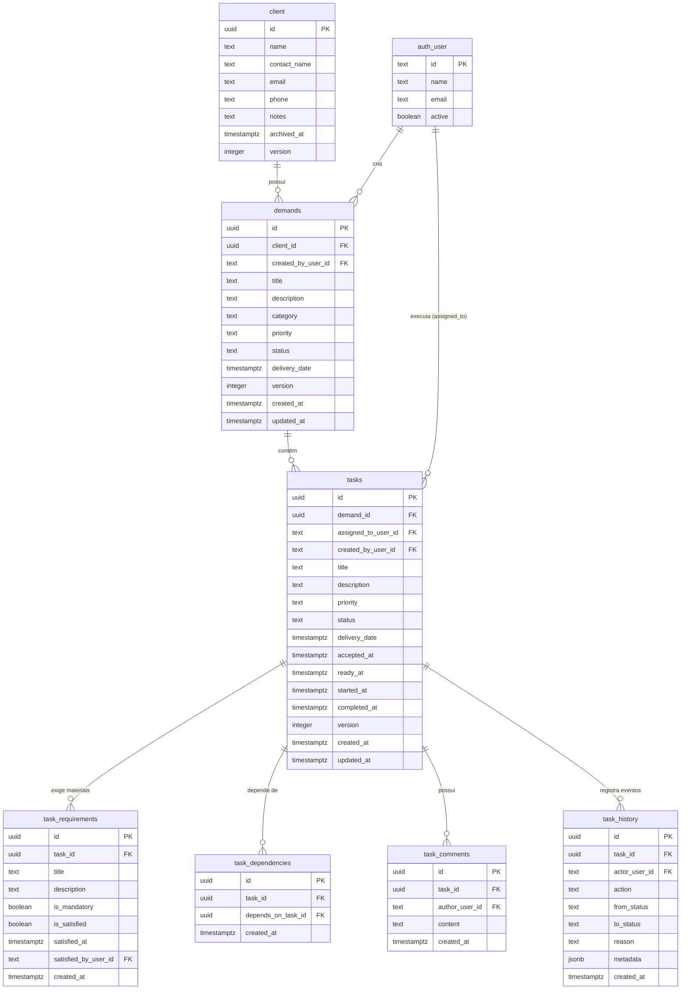
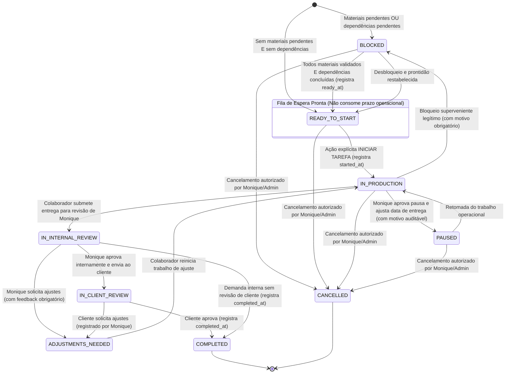

# Proposta Técnica e Especificação Inicial (Draft de Planejamento) — Fase 3: Demandas e Tarefas

- **Data do documento:** 2026-10-06 (Revisão Técnica 3 — Regra de Pausas e Ajuste de Prazos Integrada)
- **Status:** **[~] ESPECIFICAÇÃO TÉCNICA (DRAFT) — FASE 3 EM ANDAMENTO (Continuidade autorizada por AGENTS.md)**
- **Fontes de Verdade:** `PROJECT_CONTEXT.md` (seções 4, 6 e 7), `ROADMAP.md` (Fase 3 [~] EM ANDAMENTO), `AGENTS.md` (continuidade autônoma autorizada), `ADR-0005` (Início explícito e marcos operacionais), `ADR-0008` (Visibilidade vinculada de colaboradores designers) e Decisão do Responsável sobre Bloqueios, Pausas e Reprogramação de Prazos (2026-10-06).
- **Compatibilidade com Schema Existente:** Respeita integralmente as tabelas da fundação (`auth_user.id` do tipo `text`, tabela `client` com chave `uuid` e exclusão lógica via `archived_at timestamptz`, sem coluna `is_active`). Nenhuma tabela existente será alterada ou substituída.
- **Finalidade:** Propor a arquitetura conceitual, modelo de dados, contratos, endpoints, salvaguardas de concorrência/isolamento e matriz de acesso para a Fase 3, incorporando as decisões de negócio aprovadas (incluindo o fluxo administrativo de pausas e ajuste manual de data) e isolando rigorosamente os pontos acessórios ainda não definidos.

---

## 1. Visão Geral e Princípios Operacionais

A Fase 3 tem como objetivo central informatizar o fluxo operacional real da agência, tendo como caso de referência a reprodução do ciclo completo de produção de uma landing page (da concepção e identidade visual até a publicação e revisão final).

### 1.1 Princípios Fundamentais
1. **Vinculação Obrigatória a Cliente Ativo:** Toda demanda pertence a um cliente ativo cadastrado no sistema (`client_id uuid REFERENCES client(id)` onde `client.archived_at IS NULL`). Não existem demandas órfãs.
2. **Atribuição a Usuário Interno Ativo:** Tarefas são atribuídas a usuários internos com conta ativa (`assigned_to_user_id text REFERENCES auth_user(id)` onde `auth_user.active = true`). Apenas Monique e Arino (administradores) atribuem ou redistribuem demandas e tarefas.
3. **Visibilidade Contextual Restrita (ADR-0008):** Colaboradores designers visualizam **exclusivamente** os clientes e as demandas que lhes foram formalmente atribuídos. Não possuem acesso global a clientes (`clients.read`) nem acesso à gestão de equipe.
4. **Prazo de Entrega Informado pelo Criador:** Quem abre o chamado (criador) define a data de entrega alvo diretamente. Não há duração fixa/automática calculada pelo sistema por tipo de serviço e não há exigência de seleção de dias úteis versus corridos no momento do registro.
5. **Distinção Estrita entre Aceite e Início:**
   - **Aceite da Atribuição (`accept`):** O colaborador reconhece a atribuição e confirma a responsabilidade da tarefa (`accepted_at`). Isso **NÃO inicia o relógio operacional** nem coloca a tarefa em produção. Reatribuições invalidam o aceite anterior.
   - **Início da Execução (`start` — ADR-0005):** Ação operacional explícita de "INICIAR TAREFA". Exige que todos os requisitos obrigatórios e dependências estejam atendidos (`ready_at`). Grava `started_at = now()`, coloca a tarefa **EM PRODUÇÃO** e inicia o relógio operacional.
6. **Representação Verificável de Materiais e Requisitos Obrigatórios:**
   - A mera ausência de dependências entre tarefas não significa que os materiais de trabalho estejam prontos.
   - O sistema exige uma lista verificável de requisitos obrigatórios (`task_requirements`) para cada tarefa (ex.: identidade visual, textos, imagens, acessos).
   - O marco `ready_at` só é registrado quando **todas as dependências** estiverem concluídas E **todos os materiais obrigatórios** estiverem satisfeitos.
7. **Fluxo Formal de Bloqueios, Pausas e Ajuste Manual de Prazo (Decisão 2026-10-06):**
   - **Solicitação com motivo:** O responsável pela tarefa solicita o bloqueio ou pausa operacional reportando formalmente o motivo da interrupção.
   - **Aprovação administrativa por Monique:** Monique, investida da capacidade técnica do papel `administrator`, avalia a solicitação, aprova a pausa formalmente e informa a **nova data de entrega**.
   - **Histórico auditável:** O histórico da tarefa registra na mesma transação atômica o autor, o motivo, a data de entrega anterior e a nova data de entrega aprovada.
   - **Sem prorrogação automática calculada:** Não há extensão matemática automática de prazos pelo sistema; todo ajuste de data decorre de decisão humana administrativa.
   - **Sem hardcode de e-mail:** O fluxo baseia-se no perfil `administrator` (RBAC), sendo Monique o ator operacional na rotina da agência.
8. **Grafo de Dependências com Serialização contra Ciclos (DAG Concorrente):** O sistema deve impedir dependências cíclicas mesmo sob requisições simultâneas, travando a demanda durante alterações do grafo.
9. **Rastreabilidade e Atomicidade:** Toda mudança de estado e registro de histórico ocorrem na mesma transação de banco de dados, com motivo e autor obrigatórios.

---

## 2. Modelo Conceitual de Dados Proposto

> [!NOTE]
> Este modelo é estritamente compatível com o banco existente (`db/migrations/0000_foundation.sql` e `0001_clients.sql`).
> Chaves estrangeiras para usuários utilizam `text REFERENCES auth_user(id)`; chaves para clientes utilizam `uuid REFERENCES client(id)`.



### 2.1 Descrição das Entidades Propostas

1. **`demands` (Demandas):**
   - Agrupador de nível macro associado a um cliente ativo (`client_id uuid REFERENCES client(id)`).
   - `created_by_user_id`: `text NOT NULL REFERENCES auth_user(id)`.
   - `priority`: `low`, `normal`, `high`, `urgent`.
   - `delivery_date`: `timestamptz NOT NULL` informada diretamente pelo criador do chamado.
   - `version`: `integer NOT NULL DEFAULT 1` para controle de concorrência otimista.

2. **`tasks` (Tarefas Operacionais):**
   - Unidade atômica de trabalho atribuída a um usuário ativo (`assigned_to_user_id text REFERENCES auth_user(id)`).
   - `accepted_at`: `timestamptz` preenchido no aceite da atribuição. **Anulado (`NULL`) em caso de reatribuição.**
   - `ready_at`: `timestamptz` preenchido exclusivamente quando todas as dependências estiverem `completed` E todos os requisitos obrigatórios estiverem satisfeitos.
   - `started_at`: `timestamptz` preenchido no acionamento explícito de "INICIAR TAREFA".
   - `completed_at`: `timestamptz` preenchido na aprovação final da entrega.
   - `version`: `integer NOT NULL DEFAULT 1` para controle de concorrência otimista (409).

3. **`task_requirements` (Materiais e Requisitos Obrigatórios Verificáveis):**
   - Representa os insumos e critérios necessários para execução da tarefa (ex.: briefing, identidade visual, textos revisados, imagens em alta resolução, acessos ao servidor).
   - `is_mandatory`: Se `true`, a tarefa **não pode** alcançar o estado `READY_TO_START` enquanto `is_satisfied` for `false`.
   - `satisfied_at` e `satisfied_by_user_id`: Auditoria de quem validou a disponibilidade do material.

4. **`task_dependencies` (Grafo Acíclico de Dependências):**
   - Liga a tarefa dependente (`task_id uuid REFERENCES tasks(id)`) à tarefa pré-requisito (`depends_on_task_id uuid REFERENCES tasks(id)`).

5. **`task_comments` (Comunicação da Tarefa):**
   - `author_user_id`: `text NOT NULL REFERENCES auth_user(id)`.
   - Visibilidade restrita aos usuários autorizados a visualizar a respectiva tarefa.

6. **`task_history` (Linha do Tempo e Auditoria Imutável):**
   - `actor_user_id`: `text NOT NULL REFERENCES auth_user(id)`.
   - Registra transições de status, eventos de atribuição/reatribuição, aceites, início explícito, bloqueios e vereditos de revisão.
   - Gravado obrigatoriamente na mesma transação atômica (`db.transaction`).

---

## 3. Ciclo de Vida, Aceite e Início Operacional

### 3.1 Distinção Rígida entre Aceite e Início

1. **Aceite da Atribuição (`POST /api/v1/tasks/:id/accept`):**
   - Finalidade: O colaborador designer toma ciência do chamado atribuído por Monique e assume a titularidade da execução.
   - Regra: Grava `accepted_at = now()` com checagem de versão otimista (`version`).
   - **Não altera o relógio:** O aceite **NÃO** transiciona o estado para `IN_PRODUCTION` e **NÃO** inicia o relógio operacional. A tarefa pode ser aceita mesmo estando `BLOCKED`.
2. **Reatribuição e Invalidação de Aceite (`PATCH /api/v1/tasks/:id/reassign`):**
   - Operação restrita a Monique e Arino (administradores).
   - Ao transferir a tarefa do *Colaborador A* para o *Colaborador B*:
     - O backend atualiza `assigned_to_user_id = B`;
     - **Invalida o aceite:** Redefine `accepted_at = NULL`;
     - Incrementa a `version`;
     - Registra o evento em `task_history` indicando a reatribuição e a perda do aceite anterior.
     - O *Colaborador B* deverá efetuar novo aceite formal da tarefa.
3. **Início da Execução Operacional (`POST /api/v1/tasks/:id/start` — ADR-0005):**
   - Pré-condições obrigatórias validadas atomicamente no banco:
     1. Status da tarefa é `READY_TO_START` (ou seja, `ready_at IS NOT NULL`);
     2. Todas as dependências em `task_dependencies` estão com `status = 'completed'`;
     3. Todos os itens de `task_requirements` com `is_mandatory = true` possuem `is_satisfied = true`;
     4. A tarefa foi previamente aceita (`accepted_at IS NOT NULL`).
   - Efeito: Grava `started_at = now()`, avança o status para `IN_PRODUCTION`, incrementa a `version` e dispara o relógio de contagem operacional da tarefa.

### 3.2 Diagrama de Estados da Tarefa



### 3.3 Fluxo Formal de Pausas, Bloqueios e Reprogramação de Prazos (Decisão 2026-10-06)

1. **Solicitação com Justificativa Obrigatória:**
   - O colaborador responsável pela tarefa solicita formalmente a pausa ou reporta o bloqueio superveniente (`POST /api/v1/tasks/:id/request-pause` ou `/block`), fornecendo obrigatoriamente a causa (`reason`, min 5 caracteres).
2. **Aprovação Formal e Ajuste Manual da Data por Monique:**
   - Apenas usuários com capacidade administrativa (`administrator`), fluxo executado por Monique no cotidiano da agência, podem deliberar sobre a pausa (`POST /api/v1/tasks/:id/approve-pause`).
   - Se aprovada (`decision = 'approved'`), o administrador **informa obrigatoriamente a nova data de entrega** (`newDeliveryDate: ISO-8601`).
   - Se rejeitada (`decision = 'rejected'`), a solicitação é recusada com justificativa e a tarefa permanece em seu estado anterior.
3. **Auditoria Transacional Atômica (`task_history`):**
   - Na mesma transação SQL (`db.transaction`), o sistema grava:
     - `actor_user_id`: ID do administrador que homologou a decisão;
     - `action`: `'pause_approved'` ou `'pause_rejected'`;
     - `from_status`: status anterior;
     - `to_status`: `'paused'` (em caso de aprovação) ou status corrente;
     - `reason`: motivo original do solicitante + parecer administrativo;
     - `metadata`: `{ old_delivery_date: task.delivery_date, new_delivery_date: body.newDeliveryDate, requester_user_id: task.assigned_to_user_id }`.
4. **Princípios Arquiteturais Mandatórios:**
   - **Sem Prorrogação Automática:** Não há cálculo nem algoritmo que estenda prazos automaticamente por tempo pausado; a nova data é sempre fruto de deliberação humana informada no ato da aprovação.
   - **Sem Hardcode de E-mail:** A capacidade de aprovação decorre da verificação de perfil `administrator` no RBAC, sem amarrar regras de negócio a strings literais de e-mail.

---

## 4. Segurança da API, Isolamento e Matriz de Permissões

### 4.1 Revalidação Server-Side Estrita (Sem Confiar em Abas da UI)
- A ocultação de abas e botões no frontend é apenas conveniência de interface; ela **não garante segurança**.
- O backend Fastify revalida o escopo de autorização em banco de dados a cada requisição:
  1. Identifica o usuário da sessão (cookie HttpOnly assinado).
  2. Administradores (`administrator`): acesso irrestrito.
  3. Colaboradores (`collaborator`): filtros mandatórios no SQL:
     - Tarefas: `WHERE assigned_to_user_id = :userId`;
     - Demandas: `WHERE EXISTS (SELECT 1 FROM tasks t WHERE t.demand_id = demands.id AND t.assigned_to_user_id = :userId)`;
     - Comentários e Histórico: bloqueio 403 imediato se a tarefa não for atribuída ao usuário.

### 4.2 Projeção Limitada de Dados do Cliente
Em conformidade com o `ADR-0008`:
- Colaboradores **não** têm acesso ao endpoint `/api/v1/clients` (HTTP 403 mantido).
- Ao consultar demanda ou tarefa atribuída, o payload expõe apenas a projeção restrita do cliente:
  ```json
  {
    "client": {
      "id": "uuid-do-cliente",
      "name": "Nome Fantasia do Cliente",
      "brandGuidelinesUrl": "https://drive.google.com/..."
    }
  }
  ```
- **Campos estritamente omitidos:** telefones, e-mails administrativos, contatos financeiros/comerciais, observações contratuais e histórico de demandas conduzidas com outros profissionais.

### 4.3 Reatribuição com Revogação Imediata
- Ao reatribuir a tarefa para outro usuário, o colaborador anterior perde imediatamente acesso via API (suas requisições subsequentes recebem 403).
- O histórico auditável (`task_history`) permanece imutável, preservando o que o colaborador anterior executou até a data da transferência.

### 4.4 Blindagem de Privacidade em Dependências
- Quando uma tarefa depende de outra realizada por colega ou gestão:
  - O colaborador dependente vê apenas metadados públicos essenciais da pré-requisito:
    ```json
    {
      "dependencyTaskId": "uuid-da-tarefa-A",
      "title": "Criação da Identidade Visual",
      "status": "in_production",
      "isSatisfied": false
    }
    ```
  - Comentários internos, arquivos de trabalho intermediários, notas de entrega e feedback de Monique da tarefa pré-requisito permanecem confidenciais.

### 4.5 Matriz de Permissões RBAC (Proposta)

| Permissão Proposta | Papel `administrator` | Papel `collaborator` (Designers) | Regra de Autorização e Escopo |
|---|:---:|:---:|---|
| `demands.read` | **Sim (todas)** | **Restrito (atribuídas)** | Colaborador só lê demandas em que possui ao menos uma tarefa atribuída a ele. |
| `demands.create` | **Sim** | Não | Apenas Monique e administradores abrem chamados de demandas. |
| `demands.update` | **Sim** | Não | Apenas Monique e administradores alteram metadados da demanda. |
| `demands.delete` | **Sim** | Não | Exclusivo de administradores. |
| `clients.read_assigned` | **Sim (todos)** | **Restrito (projeção)** | Colaborador lê apenas dados essenciais do cliente vinculado à demanda atribuída. |
| `tasks.read` | **Sim (todas)** | **Restrito (atribuídas)** | Colaborador só lê tarefas atribuídas a ele. |
| `tasks.create` | **Sim** | Não | Criação exclusiva por administradores. |
| `tasks.assign` | **Sim** | Não | Atribuição e reatribuição exclusivas de Monique/Arino. |
| `tasks.accept` | **Sim** | **Sim (própria)** | Colaborador confirma posse da tarefa atribuída (`accepted_at`). |
| `tasks.start` | **Proposta Pendente** | **Sim (própria)** | Inicia tarefa com requisitos atendidos (`started_at`). *(Ver Seção 7 sobre Admin)* |
| `tasks.block` | **Sim** | **Sim (com motivo)** | Reporta bloqueio superveniente com causa obrigatória. |
| `tasks.submit_review` | **Sim** | **Sim (própria)** | Submete entrega para revisão de Monique. |
| `tasks.review` | **Sim (Monique/Arino)** | Não | Avaliação de entrega, aprovação e ajustes são exclusivos da gestão. |
| `task_requirements.manage` | **Sim** | Não | Adição e validação de materiais obrigatórios são da gestão. |
| `task_comments.read` | **Sim** | **Restrito (própria)** | Apenas em tarefas atribuídas ao colaborador. |
| `task_comments.create` | **Sim** | **Restrito (própria)** | Apenas em tarefas atribuídas ao colaborador. |

---

## 5. Concorrência Otimista (409) e Transações Atômicas

### 5.1 Trava de Versão Otimista e Prevenção de Duplo Início
- `demands` e `tasks` utilizam controle de versão via coluna `version integer NOT NULL DEFAULT 1`.
- Toda mutação envia a versão esperada:
  ```sql
  UPDATE tasks 
  SET status = 'in_production', 
      started_at = now(), 
      version = version + 1, 
      updated_at = now()
  WHERE id = :taskId AND version = :expectedVersion;
  ```
- Se `rowCount === 0`, retorna imediatamente `HTTP 409 Conflict` (`TASK_VERSION_CONFLICT`).
- **Idempotência no Início:** Em caso de duplo clique ou envio concorrente de `/start`, apenas a primeira requisição comita; a segunda falha com 409, garantindo que `started_at` nunca seja duplicado ou sobrescrito.

### 5.2 Atomicidade de Estado e Auditoria
Toda transição de estado e gravação de histórico são executadas na mesma transação:
```typescript
await db.transaction(async (tx) => {
  const [updatedTask] = await tx.update(tasks)
    .set({ status: nextStatus, version: sql`${tasks.version} + 1`, updatedAt: new Date() })
    .where(and(eq(tasks.id, taskId), eq(tasks.version, currentVersion)))
    .returning();

  if (!updatedTask) {
    throw new VersionConflictError('TASK_VERSION_CONFLICT');
  }

  await tx.insert(taskHistory).values({
    taskId,
    actorUserId: sessionUser.id,
    action: transitionAction,
    fromStatus: currentStatus,
    toStatus: nextStatus,
    reason: input.reason ?? null,
    metadata: input.metadata ?? null,
  });
});
```

---

## 6. Prevenção de Ciclos em Dependências sob Concorrência (DAG)

A verificação por busca em profundidade (DFS) isolada é suscetível a ciclos quando duas requisições simultâneas tentam inserir dependências cruzadas (ex.: `T1: A -> B` e `T2: B -> A`).

### Solução Arquitetural: Serialização por Demanda
Para assegurar aciclicidade absoluta sob concorrência:
1. **Início da Transação:** A rota de criação/remoção de dependências abre uma transação com o banco.
2. **Lock Pessimista no Agrupador:** Executa um lock exclusivo de linha na demanda pai:
   ```sql
   SELECT id FROM demands WHERE id = :demandId FOR UPDATE;
   ```
3. **Revalidação do Grafo:** Com a demanda serializada, recarrega todas as dependências existentes daquela demanda e executa a verificação DFS para o novo arco pretendido `(X -> Y)`.
4. **Inserção Segura:** Se nenhum caminho `Y -> ... -> X` for detectado, executa `INSERT INTO task_dependencies` e comita a transação, liberando o lock.
5. Caso um ciclo seja detectado, aborta com `HTTP 400 Bad Request` (`CYCLIC_DEPENDENCY_DETECTED`).

---

## 7. Decisões de Negócio: Consolidadas vs. Pendências Remanescentes

> [!IMPORTANT]
> **Decisões Consolidadas pelo Responsável (05/10/2026 e 06/10/2026):**
> 1. **Definição de Prazo:** O criador define a data de entrega diretamente no momento do cadastro. Não há cálculo ou duração automática vinculada a tipo de serviço e não há seleção de dias úteis/corridos.
> 2. **Pausas, Bloqueios e Reprogramação de Data:** O responsável solicita a pausa/bloqueio com motivo obrigatório; Monique (perfil `administrator`) aprova formalmente e informa a nova data de entrega manualmente; histórico registra autor, motivo, data anterior e nova data; sem prorrogação automática calculada e sem hardcode de e-mail.
> 3. **Visibilidade e Atribuição:** Apenas administradores atribuem/redistribuem; colaboradores aceitam (`accept`) formalmente antes de iniciar (`started_at`); reatribuição invalida aceite anterior; colaboradores possuem visão restrita (ADR-0008).

### 7.1 Decisões Acessórias Remanescentes (Aguardando Alinhamento)

Em estrito cumprimento às instruções do responsável e ao `AGENTS.md`, **nenhuma regra de negócio foi inventada** para os itens abaixo. A continuidade autônoma técnica da Fase 3 está autorizada, mantendo pendentes apenas estas definições acessórias de negócio:

| Item | Ponto de Indefinição | Impacto Técnico | Status |
|---|---|---|:---:|
| **1. Início de Tarefa por Administrador em Nome do Responsável** | Um administrador (Monique/Arino) pode clicar em "INICIAR TAREFA" no lugar do colaborador atribuído (ex.: em casos de urgência operacional ou ausência do designer), ou o acionamento de `/start` deve ser estritamente exclusivo do próprio colaborador atribuído? | Define as permissões da rota `/api/v1/tasks/:id/start` (se aceita papel `administrator` além de `assigned_to`). | **PROPOSTA PENDENTE DE DECISÃO** |
| **2. Cancelamento em Cascata** | Ao cancelar uma demanda principal, todas as tarefas vinculadas devem ser canceladas em cascata automaticamente, ou exige confirmação individual para tarefas já em produção? | Define regras de transação e salvaguardas contra cancelamento acidental de trabalho já iniciado. | **PENDENTE DE DECISÃO DO RESPONSÁVEL** |
| **3. Ciclo de Retrabalho Pós-Revisão do Cliente** | Quando o cliente solicita ajustes após a revisão interna, a tarefa atual retorna para `adjustments_needed` / `in_production` com nova data definida por Monique, ou a política da agência exige abertura de uma nova subtarefa de ajuste vinculada? | Impacta a granularidade do histórico e criação de tarefas filhas de revisão. | **PENDENTE DE DECISÃO DO RESPONSÁVEL** |

---

## 8. Contratos Zod Propostos (`@orium/contracts`)

```typescript
import { z } from 'zod';

export const prioritySchema = z.enum(['low', 'normal', 'high', 'urgent']);

export const taskStatusSchema = z.enum([
  'blocked',
  'ready_to_start',
  'in_production',
  'paused',
  'in_internal_review',
  'in_client_review',
  'adjustments_needed',
  'completed',
  'cancelled'
]);

// Projeção limitada de cliente para colaboradores
export const clientAssignedProjectionSchema = z.object({
  id: z.string().uuid(),
  name: z.string(),
  brandGuidelinesUrl: z.string().url().optional()
});

// Criação de Demanda
export const createDemandSchema = z.object({
  clientId: z.string().uuid('ID do cliente deve ser um UUID válido'),
  title: z.string().trim().min(3, 'Título deve ter ao menos 3 caracteres').max(150),
  description: z.string().trim().max(5000).optional(),
  category: z.string().trim().min(2).max(50),
  priority: prioritySchema.default('normal'),
  deliveryDate: z.string().datetime({ message: 'Data de entrega deve estar no formato ISO-8601' })
});

// Criação de Tarefa
export const createTaskSchema = z.object({
  demandId: z.string().uuid('ID da demanda deve ser um UUID válido'),
  assignedToUserId: z.string().min(1, 'ID do usuário responsável obrigatório'), // text compatível com auth_user.id
  title: z.string().trim().min(3).max(150),
  description: z.string().trim().max(5000).optional(),
  priority: prioritySchema.default('normal'),
  deliveryDate: z.string().datetime().optional(),
  dependsOnTaskIds: z.array(z.string().uuid()).default([])
});

// Reatribuição de Tarefa (Exclusiva Monique/Admin)
export const reassignTaskSchema = z.object({
  version: z.number().int().positive('Versão otimista obrigatória'),
  newAssignedToUserId: z.string().min(1, 'Novo responsável deve ser um ID válido'),
  reason: z.string().trim().min(5, 'Motivo da reatribuição é obrigatório').max(1000)
});

// Aceite Formal da Atribuição (Colaborador)
export const acceptTaskSchema = z.object({
  version: z.number().int().positive('Versão otimista obrigatória')
});

// Ação de Início Explícito (ADR-0005)
export const startTaskSchema = z.object({
  version: z.number().int().positive('Versão otimista obrigatória')
});

// Gestão de Requisitos / Materiais Obrigatórios
export const createTaskRequirementSchema = z.object({
  title: z.string().trim().min(3).max(150),
  description: z.string().trim().max(1000).optional(),
  isMandatory: z.boolean().default(true)
});

export const satisfyTaskRequirementSchema = z.object({
  isSatisfied: z.boolean()
});

// Submissão para Revisão Interna
export const submitTaskReviewSchema = z.object({
  version: z.number().int().positive(),
  deliveryNotes: z.string().trim().min(5, 'Informe notas da entrega/links para revisão').max(2000),
  previewUrl: z.string().url('URL de preview inválida').optional()
});

// Veredito da Revisão (Monique/Admin)
export const reviewTaskVerdictSchema = z.object({
  version: z.number().int().positive(),
  decision: z.enum(['approved_internally', 'approved_final', 'changes_requested']),
  feedback: z.string().trim().min(5, 'Feedback obrigatório ao avaliar entrega').max(3000)
});

// Registro de Bloqueio Legítimo
export const blockTaskSchema = z.object({
  version: z.number().int().positive(),
  reason: z.string().trim().min(5, 'Motivo do bloqueio é obrigatório para auditoria').max(1000)
});

// Solicitação Formal de Pausa pelo Responsável (Decisão 2026-10-06)
export const requestTaskPauseSchema = z.object({
  version: z.number().int().positive('Versão otimista obrigatória'),
  reason: z.string().trim().min(5, 'Motivo da pausa/bloqueio é obrigatório para auditoria').max(1000)
});

// Aprovação Formal de Pausa e Ajuste de Data (Monique / Administrator)
export const approveTaskPauseSchema = z.object({
  version: z.number().int().positive('Versão otimista obrigatória'),
  decision: z.enum(['approved', 'rejected']),
  newDeliveryDate: z.string().datetime({ message: 'Nova data de entrega deve estar no formato ISO-8601' }).optional(),
  notes: z.string().trim().min(5, 'Parecer ou justificativa administrativa obrigatória').max(1000)
}).refine((data) => {
  if (data.decision === 'approved' && !data.newDeliveryDate) {
    return false;
  }
  return true;
}, {
  message: 'Ao aprovar a pausa, o administrador deve informar obrigatoriamente a nova data de entrega',
  path: ['newDeliveryDate']
});
```

---

## 9. Endpoints REST Fastify Propostos

Padronização sob o prefixo `/api/v1`, autenticação via sessão de cookie HttpOnly e checagem de permissões com escopo estrito:

| Método | Rota | Descrição | Permissão e Escopo |
|---|---|---|---|
| `GET` | `/api/v1/demands` | Lista demandas (colaboradores recebem apenas demandas com tarefas atribuídas a eles) | `demands.read` (Filtro por escopo) |
| `POST` | `/api/v1/demands` | Cria nova demanda vinculada a cliente ativo com data informada pelo criador | `demands.create` (Admin) |
| `GET` | `/api/v1/demands/:id` | Detalhes da demanda (colaboradores recebem com projeção restrita do cliente) | `demands.read` (Verifica escopo) |
| `PATCH` | `/api/v1/demands/:id` | Atualiza metadados com versão otimista | `demands.update` (Admin) |
| `POST` | `/api/v1/tasks` | Cria tarefa vinculada à demanda com atribuição a usuário ativo | `tasks.create` (Admin) |
| `GET` | `/api/v1/tasks/:id` | Detalhes da tarefa, status de dependências e histórico de auditoria | `tasks.read` (Verifica escopo) |
| `PATCH` | `/api/v1/tasks/:id/reassign` | Reatribui tarefa a outro usuário ativo, **invalida aceite (`accepted_at = NULL`)** e registra histórico | `tasks.assign` (Admin) |
| `POST` | `/api/v1/tasks/:id/accept` | Colaborador aceita formalmente a responsabilidade (`accepted_at = now()`) | `tasks.accept` (Responsável) |
| `POST` | `/api/v1/tasks/:id/start` | **Início explícito**: valida `ready_at`, grava `started_at` e transiciona para `in_production` | `tasks.start` (Responsável; admin pendente de decisão) |
| `POST` | `/api/v1/tasks/:id/block` | Reporta bloqueio superveniente com motivo auditável obrigatório | `tasks.block` (Responsável/Admin) |
| `POST` | `/api/v1/tasks/:id/request-pause` | Responsável solicita formalmente a pausa da tarefa com motivo obrigatório | `tasks.block` (Responsável/Admin) |
| `POST` | `/api/v1/tasks/:id/approve-pause` | Administrador (Monique) aprova formalmente a pausa e informa a nova data de entrega (com auditoria na mesma transação) | `tasks.review` ou permissão administrativa (Admin) |
| `POST` | `/api/v1/tasks/:id/requirements` | Adiciona requisito/material obrigatório à tarefa | `task_requirements.manage` (Admin) |
| `PATCH` | `/api/v1/tasks/:id/requirements/:reqId` | Valida ou invalida disponibilidade de material obrigatório | `task_requirements.manage` (Admin) |
| `POST` | `/api/v1/tasks/:id/submit-review` | Submete materiais para revisão interna de Monique | `tasks.submit_review` (Responsável) |
| `POST` | `/api/v1/tasks/:id/review` | Monique registra parecer (aprovação interna, aprovação final ou ajustes solicitados) | `tasks.review` (Admin) |
| `POST` | `/api/v1/tasks/:id/dependencies` | Adiciona dependência com trava de serialização na demanda contra ciclos | `tasks.create` (Admin) |
| `DELETE` | `/api/v1/tasks/:id/dependencies/:depId` | Remove dependência existente | `tasks.update` (Admin) |
| `GET` | `/api/v1/tasks/:id/comments` | Lista comentários da tarefa (apenas tarefas autorizadas) | `task_comments.read` (Escopo) |
| `POST` | `/api/v1/tasks/:id/comments` | Adiciona comentário na tarefa atribuída | `task_comments.create` (Escopo) |
| `GET` | `/api/v1/tasks/:id/history` | Linha do tempo auditável de eventos e transições da tarefa | `tasks.read` (Escopo) |

---

## 10. Delimitação de Escopo e Continuidade Autônoma

- **Estado Atual:** **[~] FASE 3 EM ANDAMENTO.** Proposta técnica e especificação alinhadas com as decisões de negócio aprovadas pelo responsável em 05/10/2026 e 06/10/2026.
- **Implementação:** Nenhuma tabela criada, nenhuma migration gerada, nenhum endpoint codificado e nenhum serviço/container alterado nesta etapa. A codificação será iniciada sob orientação da coordenação (Codex).
- **Continuidade Autônoma (AGENTS.md):** A autorização de continuidade autônoma permanece plenamente ativa. As definições centrais de negócio (prazos informados pelo criador, marcos operacionais, aprovação formal de pausas por Monique e ajuste manual de data) encontram-se formalizadas. Restam pendentes apenas comportamentos acessórios de negócio (como permissão de início por administrador e detalhes do ciclo pós-revisão).
- **Próximos Passos:**
  1. Revisão e validação desta versão pela coordenação (Codex).
  2. Definição da estratégia de implementação pelo Codex (migrações Drizzle `0002_demands_tasks.sql`, contratos Zod `@orium/contracts`, rotas Fastify e componentes web).
  3. Execução da implementação técnica sob TDD e verificação de conformidade em QA.
